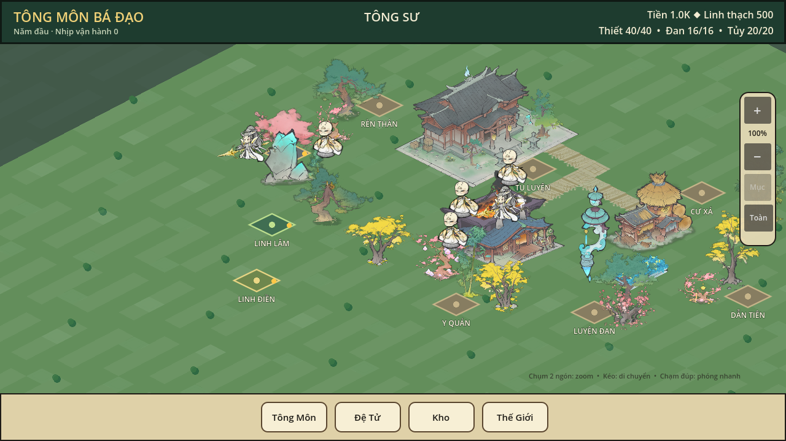
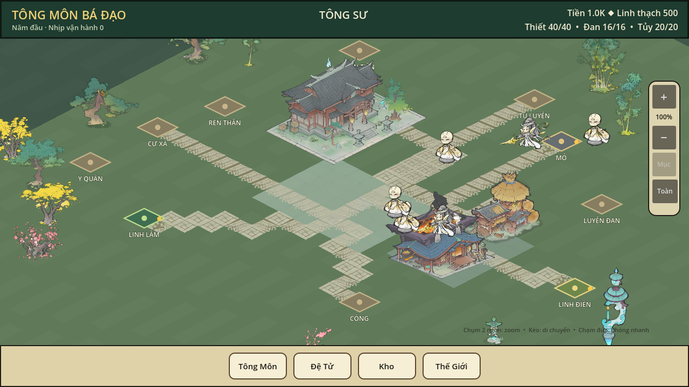

# MAP-D1B Option B — implementation and acceptance report

Date: 2026-10-25  
Repository: `vuanhtuan161094-byte/TongMonBaDao`  
Base: PR #31, `integration/pr28-combat-v3-s1-playable-qa-20261024` at `9eb4fd55733bb49bbb069240b8e332d37d22aced`  
Work branch: `feature/map-d1b-functional-hub-playable-20261025`  
Status: implementation and focused QA complete; **owner visual approval is still pending**.

## Result

Option B now runs in the real P3.2 sect scene on official Godot 4.7.2 at 1280×720. The arrangement uses the existing 192×192 map, 16×16 chunks, 48×48 starter district, camera, scene, runtime, simulation state, save service, real producer instances, and verified Source A files. The feature changes presentation anchors, terrain/road placement, and deterministic decoration placement in `SectIsometricWorldV1`; it does not add a second map, clock, or gameplay authority.

The primary visible line runs from the south entrance marker through the central paved court to the Main Hall. The verified Main Hall, Forge, and Warehouse use their real Source A sprites. The Mine, Linh Lâm, and Linh Điền are the existing real producer instances and their existing pick/management panels; their building artwork is not present in the verified set, so the map keeps the existing markers and does not pretend that a placeholder is an accepted building sprite.

This is the **sect map**. It is separate from the Thanh Trúc Lâm hunting map with 20 hunting camps.

## Layout coordinates

Coordinates are map cells in the existing starter rectangle `(72,72)` to `(119,119)`. The route seed at the Gate is only the existing presentation preview origin; it does not move a disciple or change `SimulationState`.

| Anchor | Cell | Presentation role |
|---|---:|---|
| Gate | `(96,102)` | South entrance marker and visual route origin |
| Central court / road junction | `(89,96)` | Shared connector between entrance, hall, and function districts |
| Main Hall | `(81,89)` | Main Hall on the north end of the entrance spine |
| Warehouse | `(95,91)` | East service cluster |
| Forge | `(95,95)` | East service cluster |
| Residence | `(76,97)` | West living district |
| Ren Than | `(77,93)` | West living district |
| Medicine | `(76,102)` | West living district |
| Cultivation | `(88,81)` | North training district |
| Guidance | `(78,84)` | North-west training district |
| Alchemy Hall | `(98,86)` | North-east service district |
| Mine | `(92,83)` | Real producer marker and pick target |
| Linh Lâm | `(82,104)` | Real producer marker and pick target |
| Linh Điền | `(103,93)` | Real producer marker and pick target |

The layout emits nine cardinal AStar preview routes inside the starter bounds. Route cells are checked against real building footprints and the actual P3.2 pick targets. Six verified road textures and four verified terrain textures are used. The camera remains the existing camera and limits; the capture confirms the current default framing and a separate pan/zoom view.

## Code scope and fingerprints

Changed code is limited to the packet allowlist:

1. `godot/src/presentation/p3/sect_isometric_world_v1.gd` — Option B anchors, road graph, terrain/courtyard/apron placement and filtered deterministic props.
2. `godot/tests/presentation/sect_map_d1b_layout_contract_test.gd` — new real-scene layout, navigation, footprint, pick, camera and no-simulation-mutation contract.
3. `godot/tests/presentation/tmb_map_d1b_real_capture.gd` — new real P3.2 capture/manifest harness, selected-producer panel captures and 60-second benchmark mode.

SHA-256 fingerprints of those exact source files:

| File | SHA-256 |
|---|---|
| `sect_isometric_world_v1.gd` | `4d6bb9df63f4c912a7c142f77c4d4ce310c6a3607d69c27b2e448cf610ff491c` |
| `sect_map_d1b_layout_contract_test.gd` | `d41b92eed4f504537777ed190d534c5df7a58465fa15d1b8ca96f792c705cdf1` |
| `tmb_map_d1b_real_capture.gd` | `e0418a962c5af123d466f2d693a2a0f257313ab222783ccdb54e753abe8369d5` |

The final source was run locally before its GitHub commit was created. The GitHub tree will use these same file bytes and be a child of PR #31's exact head above. Local Godot `.godot` import cache and regenerated `.import` sidecars are not part of the code diff.

## Controlled before/after evidence

Both captures use the same isolated save profile, 1280×720 viewport, default camera position, zoom `1.0`, tick `0`, and final capture harness. The full state hash changes because online wall-clock bookkeeping advances. After normalizing only `runtime_last_wall_unix`, `runtime_unconsumed_wall_seconds`, and the dictionary-backed `recruitment_candidates` row order by stable ID, the gameplay payload SHA-256 is exactly the same in both captures: `b73d26b258c8adc8df2c5648d94844f6ae11567232e5bccd7758376ea50f0e17`.

| Evidence | Before | Option B |
|---|---|---|
| Main Hall cell | `(84,86)` | `(81,89)` |
| Preview route count | `0` | `9` |
| Tick | `0` | `0` |
| Normalized gameplay payload hash | `b73d26b258c8adc8df2c5648d94844f6ae11567232e5bccd7758376ea50f0e17` | same |
| PNG SHA-256 | `ec657b30e35f82f77a38a60da8a81d8f84b399ac55ca84ece083b769ce7264b2` | `7b8d6479fe484114c14678b3b5acd6bfe1d092a9c63f632ef712e17704f782ba` |





Additional captures show the real P3.2 selection panels, not a mock map:

| View | Screenshot |
|---|---|
| Mine producer panel | [gallery_mine.png](../../../outputs/map_d1b/after/gallery_mine.png) |
| Linh Lâm producer panel | [gallery_forest.png](../../../outputs/map_d1b/after/gallery_forest.png) |
| Linh Điền producer panel | [gallery_field.png](../../../outputs/map_d1b/after/gallery_field.png) |
| Pan and zoom | [gallery_panzoom.png](../../../outputs/map_d1b/after/gallery_panzoom.png) |
| Windows portable ZIP smoke | [portable_smoke.png](../../../outputs/map_d1b/after/portable_smoke.png) |

SHA-256 for the complete seven-image evidence set is listed in [screenshot_sha256.txt](../../../outputs/map_d1b/screenshot_sha256.txt). All captures are 1280×720 from the final P3.2 runtime capture harness.

The producer panel screenshots show their existing authoritative fields. The panel and walking actors can crowd the map/HUD at some camera positions; this is recorded for the owner visual review. The map layout code does not change P3.2 panel geometry outside the packet allowlist.

## Source A asset gate and gaps

The unchanged `map25_source_a_verified.json` contains 32 SHA-pinned PNGs. The final Godot 4.7.2 asset contract passed `accepted=32 missing=0 rejected=0`; all 32 raw PNGs exist locally. The default P3.2 render loaded 30 assets. Two hash-verified vegetation records were not requested by the final prop set: `570183.png` is deliberately unused because its semantics are not needed, and `570181.png` is SHA-valid but is filtered from the rendered set by the final placement checks. Neither is a missing or rejected source file.

Verified groups used by the map:

- 4 terrain textures: courtyard, border, runes, and variant stone.
- 6 road textures: axis A/B, branch, cross, junction, and scatter.
- 17 Source A vegetation props drawn in the final default capture.
- 3 Source A building sprites: Main Hall `510052`, Forge `520081`, and Warehouse `510102`.

No verified gate, residence, training hall, Mine, forest worksite, or Spirit Field building art is in this 32-file manifest. No verified water, bridge, cliff, slope, or height-transition set is in it. The detailed per-file SHA/runtime matrix and the missing-art recovery list are [source_a_asset_matrix.csv](../../../outputs/map_d1b/source_a_asset_matrix.csv) and [asset_gap_matrix.csv](../../../outputs/map_d1b/asset_gap_matrix.csv). No master Source A art, input PNG, or manifest was changed.

## Focused tests

Official Godot: `4.7.2.stable.official.ed1daf0bf`. Final run: **29/29 PASS** — all 28 PR #31 focused tests plus the new MAP-D1B layout contract. The 28-test set includes the 56-check Combat V3-S1 edge contract. O9 multi-producer rehearsal passed. The new contract reports:

```text
MAP-D1B LAYOUT CONTRACT PASS routes=9 roads={branch:8, axis_a:35, scatter:20, axis_b:21, cross:3, junction:8} terrain={variant:30, border:24, courtyard:22, runes:2} props=17 producers=3
```

It checks all 13 unique anchors are inside the starter; route connectivity and footprint clearance; the real Mine/Forest/Field instance IDs; actual P3.2 producer picking; zoom at `0.75`, `1.0`, `1.35`, `1.8`; pan; and unchanged `SimulationState` after presentation operations.

Per-test Godot logs and a CSV with exit code and pass marker are in [final_29_verified](../../../outputs/map_d1b/logs/final_29_verified/). The full focused result is [focused_results.csv](../../../outputs/map_d1b/logs/final_29_verified/focused_results.csv). No FULL or CI run was performed.

The Godot logs include the host's `Failed to read the root certificate store` startup diagnostic. It did not prevent script loading or any test pass marker; it is recorded as a local environment warning, not suppressed.

## Windows performance measurement

This is a sustained runtime measurement, not an FPS estimate from a screenshot. The final P3.2 scene ran with official Godot 4.7.2, the OpenGL Compatibility renderer on an Intel Iris Plus GPU, and the 1280×720 viewport. The harness warmed up for 5 seconds, then collected 60 one-second windows. A PowerShell monitor sampled the Godot process Working Set once per second for 78 samples including launch.

| Metric | Result |
|---|---:|
| Average FPS across 60 windows | 59.74 |
| Median one-second FPS | 60.02 |
| 5th percentile one-second FPS | 56.20 |
| Minimum one-second FPS | 55.10 |
| Process frame-time median / p95 | 18.42 ms / 64.54 ms |
| Physics frame-time median | 0.059 ms |
| Median draw calls per sampled frame | 33 |
| Godot static-memory median / max | 55.99 MiB / 56.22 MiB |
| Windows process Working Set median / p95 / peak | 505.12 MiB / 738.59 MiB / 738.75 MiB |

Working Set includes startup and resource initialization; it settles around 505 MiB after the initial high sample. Frame-time p95 shows spikes despite the near-60 FPS median, so sustained smoothness should still be judged in owner/manual play. Raw telemetry and one-second Windows memory samples are [windows_benchmark_evidence.json](../../../outputs/map_d1b/logs/windows_benchmark_evidence.json) and [windows_working_set_samples.csv](../../../outputs/map_d1b/logs/windows_working_set_samples.csv).

## Portable project and remaining acceptance

A local Windows portable Godot project bundle is supplied with official Godot 4.7.2, the real project, and a one-click launcher. The launcher opens P3.2 at the project-configured 1280×720 without Administrator and directs save data to a new package-local userdata folder. The ZIP was extracted and smoke-tested with both official Godot headless startup and the real P3.2 GUI capture harness; both exited successfully, and the GUI capture produced a verified 1280×720 image. ZIP SHA-256: `266e40f8106ae49fece8b97f29e9252a2dc0bd65a6ce2da656bbacc07a6044c0`. Portable GUI screenshot SHA-256: `0e81528ebd46f74bebfee267b0b2eb34e39b244dc82a24632a767dc9b1241b7b`. This is a portable Godot project bundle, **not a standalone exported game EXE**; the Godot 4.7.2 export templates are absent.

| Acceptance item | Status |
|---|---|
| Official Godot 4.7.2 focused regressions | PASS 29/29 |
| Option B real P3.2 scene and producer selection | PASS automated GUI capture + layout contract |
| Runtime/save payload unchanged by presentation | PASS; matching normalized hash in controlled pair |
| Windows sustained performance | Measured; frame-time spikes remain for review |
| Windows manual play by owner | PENDING |
| Owner visual approval | PENDING; prototype only |
| Android / touch device | PENDING |
| Full / CI | Not run, per instruction |
| Portable ZIP extracted headless + real-scene GUI smoke | PASS; see package smoke log and image |
| Standalone exported game | PENDING; export templates unavailable |

## MAP-D1B boundary

No Combat, CARE, Warehouse, SaveService, D7, economy, Injury, scheduler, camera authority, Source A master, or asset manifest code was changed. No merge was done. The remote branch and new Draft PR are stacked on PR #31; PR #24–#31 remain unmerged and untouched.

The design-only district C, 30 Mine / 30 Linh Lâm / 40 Linh Điền scale study and asset/LOD strategy are in [TMB_MAP_D1B_DISTRICT_C_ASSET_LOD_PLAN_2026-10-25.md](TMB_MAP_D1B_DISTRICT_C_ASSET_LOD_PLAN_2026-10-25.md). No district C code was added.
