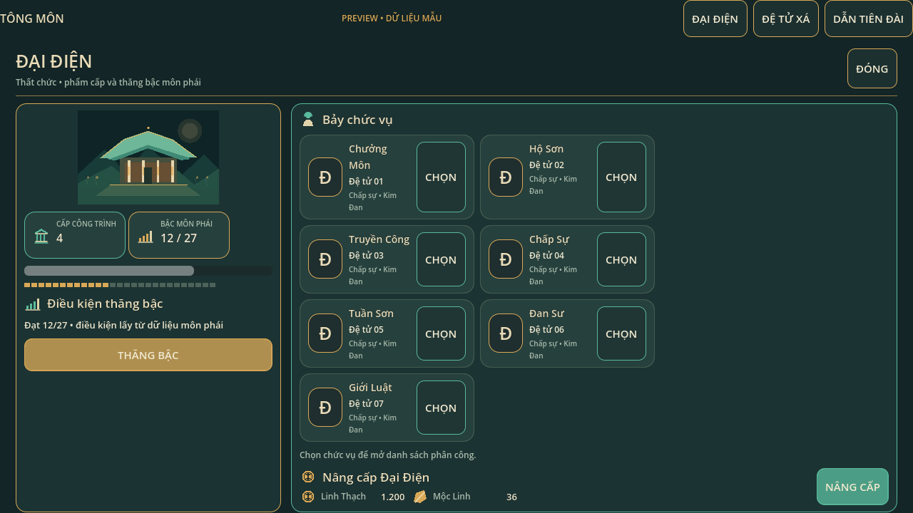
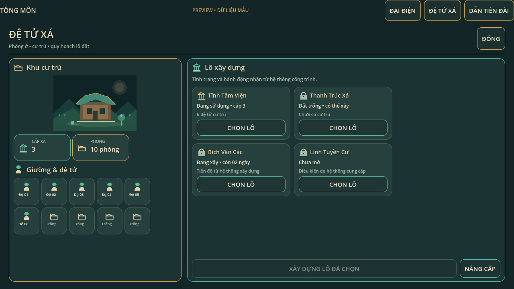
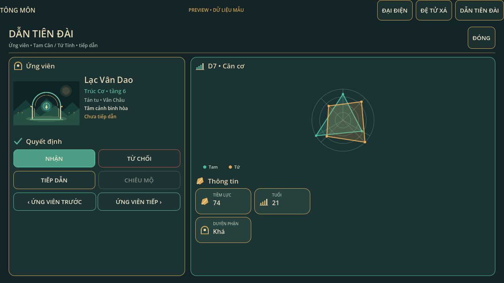

# B1 three facility screens — integration preview

## TRI-01 visual V2 addendum — 2026-11-02 (PR #67)

Status: CODE COMMITTED; Godot 4.7.2 new-art CI RUNNING at `d92a21ee79981260c994eedc0859fd1d688eca1c` when authored. Visual approval, physical mouse and Android are still **PENDING USER**. This visual layer is presentation-only; it does not change Hall, Residence, Recruitment, SaveService, economy or PvE rules.

**What changed:** The three B1 views now use `sect_facility_art_v2.gd` through the shared theme. The renderer first requests the in-repository Source A main-hall art `res://art/source_a_env02a/pv01_assets/main_hall/510052.png`, exclusively through `SectMap25SourceArt.texture_for()`. The source gate checks the fixed map25 manifest SHA-256 `b6bf88c35e3edc33aba822124296af15a5c8491a05c28f6b5d7b342d20d5325c` before returning the texture. If unavailable, it falls back to **new original art**, not a false Source A attribution.

- `res://art/uiux/hall_paint_v2.svg`: original hall composition, fallback only.
- `res://art/uiux/residence_paint_v2.svg`: original residence courtyard composition; no approved source residence PNG exists in the repository at this checkpoint.
- `res://art/uiux/guidance_paint_v2.svg`: original guidance ceremonial gate composition; this is not a disciple portrait.
- `sect_facility_illustration_v1.gd` remains a final fallback if SVG texture import fails.
- The Source A verification tooltip distinguishes imported source from original study artwork; missing office portraits use a neutral unassigned silhouette, not duplicated name initials.
- B1 art has more vertical space, borders/shadows are tuned for 1280×720 and touch-oriented buttons remain at least 46px high.

**Asset authority caveat:** `docs/P3_ASSET_REGISTRY.json` still records historic approved S3 building masters as unrecovered. The above main-hall texture is a **different, identifiable Source A runtime candidate**, not a claim to have recovered that historical S3 master. Original V2 illustrations are a new study, not a replacement labeled as the previously approved source. Do not use their presence as proof of production visual acceptance or distribution rights.

**Automated evidence requested in existing O2 workflow:** official 4.7.2 import, source-art-script `--check-only`, `tri_facility_b1_art_v2_test.gd` (imported texture and SHA gate), existing B1 callbacks, in-engine real-state UI captures, SaveService and P3.6A checks. No PASS is claimed until GitHub run concludes; follow the run on the exact source SHA. The runtime image output, not these original B1 gallery PNGs, is the evidence to review.

**Open gates:** owner visual selection of illustration style; high-resolution source portraits actually mapped to candidate/appointed disciple identities; production-art provenance for Residence/Guidance; physical Windows mouse/Android; total CI regressions unrelated to this visual-only diff; verify exported Android fallback preloads and SHA-gated PNG behavior on device.

Branch: `feature/codex-b-uiux-b1-20261102`  
RC base: `rc/one-game-playable-20261101` @ `970af33b23076c80d677cf5898a721a27504708f`

This package adds three Godot-native presentation screens and a standalone preview gallery. Each screen exposes `bind_view_model(view_model: Dictionary)` and typed intent signals. It does not call simulation, save, scheduler, economy, building, warehouse, recruitment, or combat authority.

## View-model and callback contract

| Screen | Read-only input fields | UI intent signals |
|---|---|---|
| Đại Điện | `building_level`, `rank_step`, `rank_progress`, `rank_requirement`, `can_promote`, `can_upgrade`, `upgrade_costs[{name, amount, icon}]`, `offices[{id, disciple_name, portrait, office_rank}]` | `office_selection_requested(role_id)`, `promotion_requested`, `hall_upgrade_requested`, `closed` |
| Đệ Tử Xá | `building_level`, `room_count_label`, `bed_slots[{id, occupied, disciple_short_name}]`, `sites[{id, name, status, resident_summary, built, can_build, can_upgrade}]`, `selected_residence_id` | `site_selection_requested(site_id)`, `residence_build_requested(site_id)`, `residence_upgrade_requested(residence_id)`, `closed` |
| Dẫn Tiên Đài | `candidate[{id, name, realm, origin, personality, status, portrait, source_art_approved, tam_values[3], tu_values[4]}]`, `can_accept`, `can_reject`, `can_lead_in`, `can_recruit`, `metrics[{label, value, icon}]`, optional `radar_factory: Callable` | `candidate_page_requested(direction)`, `accept_candidate_requested(candidate_id)`, `reject_candidate_requested(candidate_id)`, `lead_in_requested(candidate_id)`, `recruit_candidate_requested(candidate_id)`, `closed` |

The host supplies all costs, status text, rank progress, occupancy, candidate values, and action eligibility. Screens only display those values and emit intents with IDs. The D7 radar renders three Tam and four Tứ values as separate series. The host may pass a factory for its canonical radar control.

## Rendered 1280×720 captures

These were captured from the Godot 4.7.2 OpenGL game viewport with the gallery capture runner. They show sample data and are not connected gameplay.

- Đại Điện: 
- Đệ Tử Xá: 
- Dẫn Tiên Đài: 

## Verification

Godot binary: `Godot_v4.7.2-stable_win64.exe`, `4.7.2.stable.official.ed1daf0bf`.

| Check | Command / evidence | Result |
|---|---|---|
| Import | `--headless --path <QA>/godot --editor --quit` | PASS, exit 0 |
| Callback/data contract | `--headless --path <QA>/godot --script res://tests/presentation/b1_trifacility_ui_contract_test.gd` | PASS, exit 0 |
| 1280×720 layout host | `--headless --path <QA>/godot --script res://tests/presentation/b1_trifacility_layout_test.gd` | PASS, exit 0 |
| Render captures | `--path <QA>/godot --script res://tests/presentation/b1_trifacility_capture_screenshots.gd -- <output-dir>` | PASS, all three 1280×720 PNGs saved |

The Windows runner prints `Failed to read the root certificate store` during startup; the engine commands exit 0 and import/tests/capture succeed. GUI mouse review through Computer Use was unavailable because its app approval timed out. The saved captures were visually inspected as image files; owner visual review remains pending.

The QA source clone is isolated under Codex documents and came from local main SHA `5e6fdd966bdf710b71e2a1539bb712e44069a4bb`, not the exact RC checkout. B1 files are new and self-contained under `godot/src/presentation/uiux`, its preview scene and presentation tests; the remote commit is based on current RC `970af33...`. The import/test result therefore validates these new components in Godot 4.7.2 but is not an RC integration or gameplay acceptance.

## Screen coverage and asset boundary

- **Đại Điện:** seven role cards with portrait slots/placeholders, building level, 27 supplied rank segments, supplied requirement and costs, eligibility-gated promotion/upgrade callbacks.
- **Đệ Tử Xá:** original facility illustration, supplied bed/resident records, selectable plot cards with supplied state, build and upgrade intent callbacks.
- **Dẫn Tiên Đài:** caller-approved optional portrait texture; original vector fallback; candidate details; independent 3-value Tam / 4-value Tứ radar; accept/reject with two-tap rejection; lead-in and recruit intents.
- The gallery labels all fixtures as sample data. It is an integration preview, not connected gameplay.
- No Source A/JX or third-party art is included. All illustrations and glyphs are original Godot vector drawing code.

Host-game integration, wiring of current game data/actions, portrait rights/candidate tests, and owner visual review remain pending.
