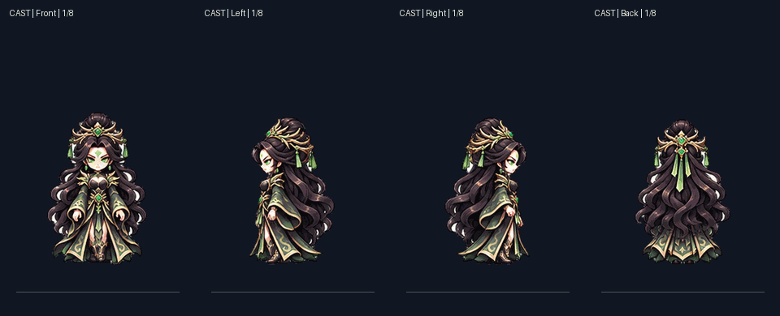
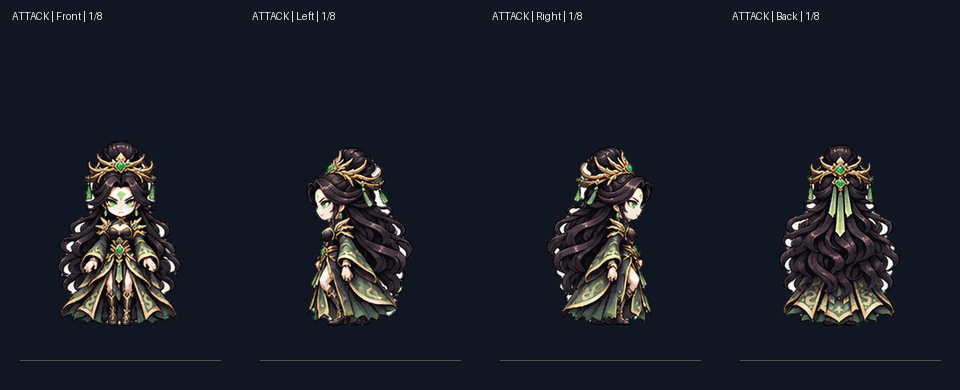
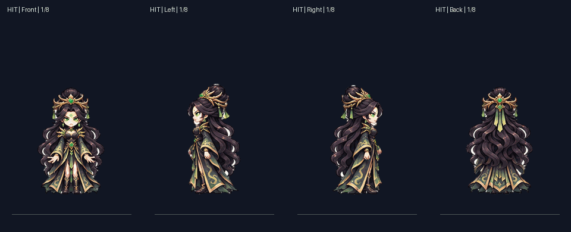
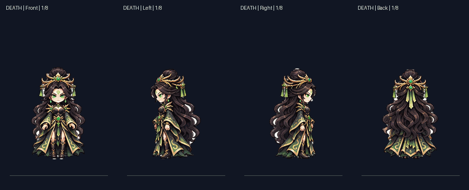

# Nữ Độc Tu V4 — review candidate

This folder stores the owner-provided V4 four-direction sprite candidate, its locked identity source, atlases, and actual motion-review GIFs. It is isolated under the character-family review area. It is not connected to Combat Lab, P3.2 actors, or production rendering.

## Motion previews

Cast:

Attack:

Hit:

Death:

These are the actual GIFs from the supplied V4 archive, not concept screenshots.

## Verdict

The four-view master matches the immutable approved SHA. The candidate preserves the Nữ Độc Tu identity and jade, ink-black, and antique-gold palette. It is good enough to review as an animation candidate, not as a finished production animation family.

The action sheets show changing poses. Cast and Attack have green projectile/light baked into the frames, target-size review at 60–75 px is pending, and no official Godot 4.7.2 import or GUI capture has been completed. The earlier owner decision accepted these GIFs as process examples, not as a production asset release.

The archive does not include the raw action images referenced by the builder, so it is not a self-contained regeneration route. The committed PNGs, GIFs, manifests, hashes, and master preserve the reviewable output and provenance.

## Files

- Seven PNGs: approved master plus Idle, Walk, Cast, Attack, Hit, and Death atlases.
- preview/: four real 8-frame GIF reviews.
- manifest.json: file SHA-256, byte size, dimensions, frame grid, pivot, provenance, and remaining gates.

Atlas rows are front, left, right, back. Each cell is 320×384 with pivot (160,351). Idle has one still frame per direction. Atlas availability alone does not prove a runtime-ready clip.
