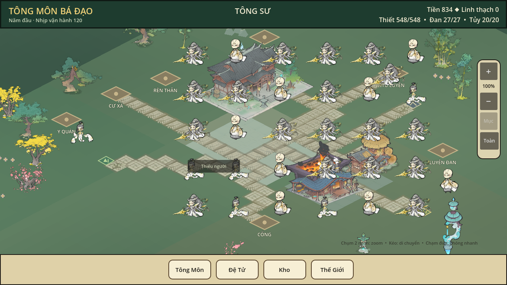
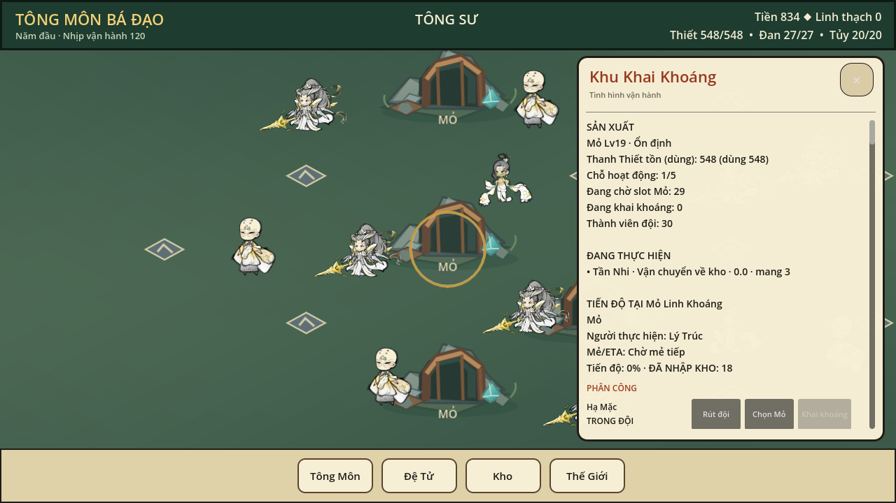
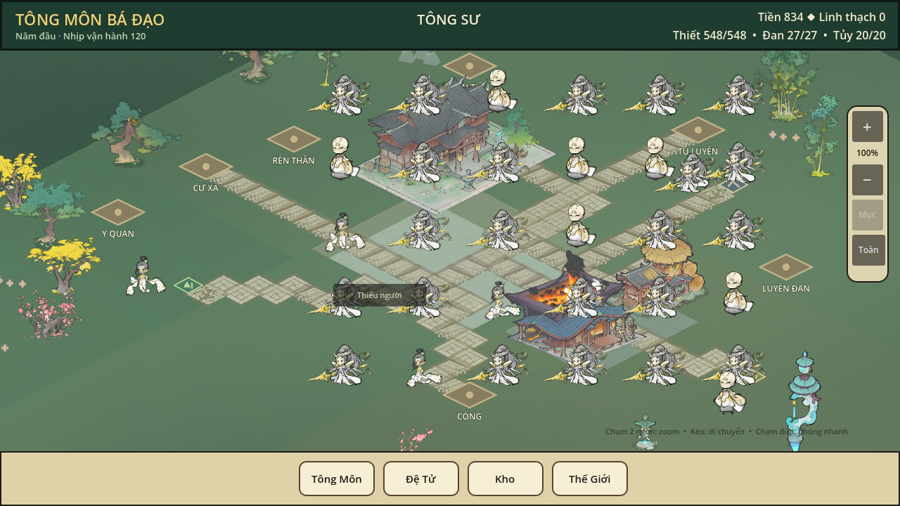

# TÔNG MÔN BÁ ĐẠO — PR #39 Endgame QA

Ngày nghiệm thu: 2026-10-26
Godot: official `4.7.2.stable.official.ed1daf0bf`
Baseline PR #39: `087be910c919bafbcfdc52de898747f9b8fdf49f`
Final branch HEAD / PR #39 HEAD: `8c7e2e6145200af4ec5538c359d55abbe5c0c7a2`
Gameplay/pooling commit đã chạy focused: `ae3902484e01ebbaec3f97b695a06ddaa3be53b4`
Runner/focused profile 200 verification commit: `3c04baac5a7773445482c6df418a57bf4d995d95`

Không chạy FULL/CI, không merge. Bốn commit đã được fast-forward push lên nhánh `feature/endgame-visual-lod-pve-world-foundation-20261025`; GitHub xác nhận PR #39 vẫn Draft, open và unmerged tại final HEAD nêu trên. Không thay đổi save gốc, Source A/JX master, PR khác, Combat V2, economy, Injury, Warehouse hay SaveService.

## Kết quả

| Hạng mục | Trạng thái | Bằng chứng |
|---|---|---|
| P3.2 endgame 130 đệ tử, 100 worksite canonical | PASS | 30 Mỏ, 30 Linh Lâm, 40 Linh Điền; 25 work cycles sau roundtrip; invariants rỗng |
| P3.2 endgame 200 đệ tử | PASS | Fixture canonical tạo mới, 120 simulation tick, 100 người được phân vào 100 site; Save/Load/invariants PASS |
| Actor pooling/virtualization và culling | PASS | 130 vị trí canonical; density test dựng 6 actor, pool 34, selection vật thể ảo được, không đổi `SimulationState`; tween stale identity đã có regression |
| Focused regression | PASS | 29/29 tại gameplay SHA `ae39024`; thêm 6/6 map/PvE foundation tại cùng SHA |
| Save/Load trong scene P3.2 | PASS | 130 và 200: đúng roster, 103 công trình, Kho, tick, invariant; mở scene mới từ cùng save thành công |
| GUI capture thật 1280×720 | PASS (automation) | P3.2 production scene, camera pan/zoom, chọn đúng `mine_021`, `linh_forest_021`, `spirit_field_035`, save/reload |
| Thao tác chuột thủ công qua cửa sổ Godot | PENDING | Cửa sổ đang mở nhưng Computer Use không trả về window Godot; không gửi input mù |
| Hồ sơ 500 | BLOCKED | Windows chỉ còn 2.42 GB RAM trống, dưới cổng 2.50 GB; không khởi chạy Godot profile 500 |
| PvE Thanh Trúc Lâm 10–20 quái/6 đệ tử với loot từng quái | BLOCKED | Population/HP0 foundation có test; chưa có adapter gameplay + bảng loot canonical theo từng quái |
| Asset Source A cho Mỏ/Linh Lâm/Linh Điền | BLOCKED | Trong 263 QA_PASS chưa có role mapping high-confidence phù hợp; ba SVG hiện tại vẫn là placeholder |
| Video | PENDING | Không có ffmpeg/OBS trên máy; bộ ảnh runtime có thật đã tạo |
| Android và owner visual acceptance | PENDING | Chưa có thiết bị và owner nghiệm thu |

Các PNG hiển thị bối cảnh gameplay từ scene P3.2 thật. Dãy zoom được chụp ở 0.75, 1.0, 1.35 và 1.8. Captures được tạo bằng harness gửi input vào handler của scene; đây là GUI automation, không phải click thủ công của người chơi.

### 130 đệ tử

### 200 đệ tử

## Code đã thay đổi

Gameplay commit `ae39024`:

- `godot/src/presentation/p3_2_landscape_sect.gd`: virtual location cho toàn bộ roster; chỉ materialize actor trong camera/LOD budget; recycle, pool, dọn visual khi bind lại; camera focus được đệ tử đang ẩn; hủy tween khi recycle để không kéo actor cũ về vị trí đệ tử trước. P3.1 không còn dựng rồi hủy một roster UI subtree cho mỗi đệ tử.
- `godot/src/presentation/p3/modular_disciple_actor.gd`: reset identity/animation/Source A visual để tái sử dụng an toàn.
- `godot/tests/presentation/endgame_map_density_test.gd`: 100 vị trí producer không chồng/ngoài grid, test chọn hidden disciple, pool reuse/teardown, không đổi state, regression stale tween.
- `godot/src/simulation/combat/pve_multi_camp_population_v1.gd`: chỉ khai báo kiểu `int` cho kết quả `pop_front` để tránh suy luận `Variant` của Godot strict warning; không mở rộng combat/loot.
- Harness/launcher/tests trong `godot/tools/qa/`, `tools/qa/` và `Run-Endgame-QA.cmd` dùng output, save, `APPDATA` và `LOCALAPPDATA` cách ly.

Commit `3c04baa` sửa cú pháp PowerShell ở nhánh cảnh báo memory gate. Không đổi gameplay; profile 200 contract được chạy lại ở exact SHA này.

## Test và logs

- 29/29 focused ở `ae3902484e01ebbaec3f97b695a06ddaa3be53b4`: [CSV](logs/focused_29_final_20261026_013707_831/focused_results.csv). Bao gồm `combat_v3_s1_edge_contract_test.gd` **56 checks PASS**, B3 hunt/CARE/Injury120/pills, Combat V2 snapshot/30-actor, P3.2 camera, O9, Source A gate, map projection, Save/Load.
- 6/6 map/PvE foundation ở cùng SHA: [CSV](logs/endgame_map_additional/focused_results.csv). Bao gồm density, 100 producer cells, map contract, population registry, HP0 bridge.
- 200-roster generation+contract ở `ae39024`: [results](logs/roster_profiles_20261026_014439_615/roster_profile_results.csv). Contract được chạy lại ở `3c04baa`: [results](logs/roster_profiles_20261026_015130_656/roster_profile_results.csv).
- 500 memory gate: [BLOCKED log](logs/roster_profiles_20261026_015321_617/roster_profile_results.csv), RAM khả dụng `2.42 GB < 2.50 GB`; Godot không được chạy cho profile này.
- Density tween regression standalone: [log](logs/actor_pool/density_tween_fix.log).
- Hai GUI capture logs: [130](logs/gui_capture/capture_130.log), [200](logs/gui_capture/capture_200.log). Các dòng root-certificate-store là warning môi trường Windows; mỗi lệnh thoát code `0`, có marker evidence.

Negative SaveService cases trong một số focused test cố ý gửi save sai; các dòng `ERROR` tương ứng là expected rejection, process code `0` và pass marker có mặt.

## Endgame state và tài nguyên

130 và 200 là **synthetic QA seed có thể tái tạo**, không phải tuyên bố rằng người chơi đã tiến hóa tự nhiên tới trạng thái đó. Generator dùng `RecruitmentSystem`, `BuildingSystem`, `WorkforceSystem`, canonical `SimulationState`, scheduler và `SaveService`; không vẽ công trình/đệ tử giả trên map.

| Roster | Mỏ | Linh Lâm | Linh Điền | Cấp hỗ trợ thực tế | Lô sản xuất / đơn vị | Save/Load |
|---:|---:|---:|---:|---|---|---|
| 130 | 30 × Lv19 | 30 × Lv1 | 40 × Lv100 | Đan Tiên Đài Lv100; Luyện Đan Đường/Rèn Thần Đường Lv1 | 404 / 1,497 | PASS, tick120, 103 buildings, 25 work cycles |
| 200 | 30 × Lv19 | 30 × Lv1 | 40 × Lv100 | như 130 | 401 / 1,468 | PASS, tick120, 103 buildings, 25 work cycles |

Kho 130 seed: Thanh Thiết 548, Thanh Linh Thảo 175, Linh Mộc 364. Kho 200 seed: Thanh Thiết 548, Thanh Linh Thảo 161, Linh Mộc 364. Capture/save/reload giữ nguyên đúng Kho đã đọc. SHA seed 130 được đọc trước/sau: `BA1B98D16A6CA26E08915981CA273769F9F23FF15A72F21B5BDD522D8CBB36E1`, không thay đổi. Save QA 200 mới: 1,663,602 bytes, SHA `E0EE041E433B93AAE9CBF2FE027638D0AAEB00D59826D5ADDB55BBB286E8463B`; file nằm trong worktree dưới `godot/qa/`, bị `.gitignore` loại khỏi PR.

Simulation generator của profile 200 báo `372,074 ms` cho 120 tick (120 simulated minutes), trước khi lưu. Đây là một tín hiệu hiệu năng endgame cần xử lý riêng; không sửa scheduler trong phạm vi mốc này vì cần profiler và regression authority độc lập.

## FPS và RAM

Đo trên Windows, Intel Iris Plus / OpenGL Compatibility, machine total memory 7.71 GiB. Capture sample dùng 600 frames và wall-clock thật khoảng 9.99 s:

| Roster | Mean FPS | Min | Max | Godot static memory | Process working set observation |
|---:|---:|---:|---:|---:|---:|
| 130 | 54.30 | 2 | 60 | 114,605,380 bytes | chưa lấy peak process sample |
| 200 | 54.19 | 2 | 60 | 130,933,736 bytes | quan sát khoảng 989 MB trong capture; launcher sau startup khoảng 609 MB |

Đây không phải benchmark Android hay cam kết 60 FPS; min 2 cho thấy có frame hitch cần profiler dài hơn. RAM khả dụng trước khi capture 130 là 2.53 GB, trước 200 là 2.52 GB; sau khi launcher 200 mở khoảng 1.89 GB. Không khởi chạy profile 500 khi không đạt memory gate.

## Asset Source A

- Catalog thư viện: `E:\TongMonBaDaoWorkspace\03_AssetLibrary\SourceA`; `catalog.jsonl` SHA-256 `2A5AD69A9B2E44F0D5DB32AD5B733E71F7F82656C719F98F8AA9B2D6D9F88D33`.
- Có 263 dòng `QA_PASS`, kèm source/output SHA, clip list, FPS, pivot, dimensions và Godot path trong [catalog CSV](assets/sourcea_qa_pass_asset_catalog.csv). Phân loại: 73 character/disciple, 2 monster, 41 NPC, 2 UI/icon, 145 unknown; 118 confidence thấp, 145 unknown. Chỉ 10 ảnh có preview để xem trực quan trong [contact sheet](assets/sourcea_qa_pass_preview_sheet.png).
- 32 PNG Source A ENV02A trong project và các terrain/road/MAP25 hiện có không bị thay hoặc chuyển đổi lại. Không thêm/bake asset mới.
- Không có high-confidence worksite role cho Mỏ/Linh Lâm/Linh Điền/Cư Xá/Luyện Khí trong QA catalog. Ba SVG worksite hiện hành vẫn là placeholder thử nghiệm, không phải Source A đã duyệt.
- Monster `1113031_1` có 16 source clips ở 30 FPS, pivot (384,540), canvas 768×768; Godot bundle có `stand/walk/attack1/hit/dead` và được reuse as-is trong P3.2. Phân loại vẫn low-confidence, visual không chứng minh đây là sói Thanh Lang. `1110011` chỉ có `stand`, thiếu attack/death.

## PvE blocker

`PveMultiCampPopulationV1` vẫn là registry spawn-slot/respawn và xác minh HP0; nó không mô phỏng HP, hành động, đệ tử, loot hoặc tick. Topology/registry/HP0 bridge test PASS **không** đồng nghĩa có gameplay nhiều bãi. Bộ focused xác nhận MapBattleV2 có thể chạy group combat tối đa 30 actor qua nhiều party và từng party tối đa 6, nhưng chưa có adapter gắn roster 6 vào bãi 10–20 quái, loop tái sinh thế giới, receipt per-monster và canonical Kho settlement trong P3.2. Bảng loot cũ dùng resource ID không khớp registry Kho; không tự đổi mapping hay chia aggregate reward. Vì thiếu nguồn loot canonical được phép, không triển khai/nhận PASS multicamp combat ở mốc này.

## PENDING và cách tiếp tục

- Người chơi cần kiểm tra mouse controls/đọc chữ; cửa sổ Godot 200 đang mở trên desktop `Tong Mon Ba Dao (DEBUG)` với save cách ly. Computer Use provider không liệt kê cửa sổ đó nên chưa gửi chuột.
- Video encoder không cài sẵn. Screenshot capture thật đã lưu tại `godot/outputs/endgame_qa_20261026/gameplay/roster_{130,200}/`.
- Android device, owner visual approval, 500-roster, profiling hitch, verified worksite art và PvE per-monster canonical loot còn PENDING/BLOCKED như bảng đầu.
- Launcher một lần nhấn: [Run-Endgame-QA.cmd](../../Run-Endgame-QA.cmd). Hướng dẫn: [README_vi.md](README_vi.md).
